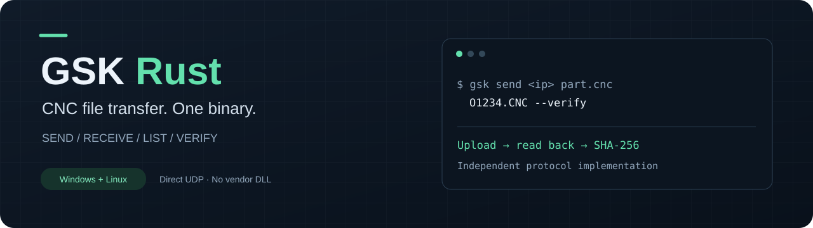

<p align="center"></p>

<p align="center">
  <a href="https://github.com/drockso/gsk-rust/actions/workflows/ci.yml"></a>
  <a href="https://github.com/drockso/gsk-rust/releases/latest"></a>
  <a href="LICENSE"></a>
  
</p>

<p align="center"><b>English</b> · <a href="README.ru.md">Русский</a> · <a href="https://github.com/drockso/gsk-rust/releases/latest">Download</a> · <a href="docs/PROTOCOL.md">Protocol notes</a> · <a href="docs/HARDWARE-2026-11-07.md">Hardware test report</a></p>

**Upload and download GSK CNC programs directly from the command line.** `gsk` is an independent Rust implementation of the Ethernet file protocol used by GSKComm's MiniSock library. It talks to the controller over UDP; it does not load a vendor DLL, automate a GUI, or require .NET.

One executable per platform. Use it from a terminal, an editor's external-tool command, or a script.

```console
gsk send 192.168.1.100 part.cnc O1234.CNC --verify
```

## What it does

| Command | Purpose |
|---|---|
| `send` | Upload a local file, with optional read-back verification |
| `receive` | Download a program, publishing the local file only after success |
| `list` | Enumerate the controller's program directory |
| `stat` | Show a program's size and mode |
| `verify` | Download and compare SHA-256 without writing to the controller |

- **Byte-preserving transfers:** no edits to program numbers, text encoding or line endings.
- **Read-back verification:** compare the uploaded bytes with what the controller actually returns.
- **Predictable failures:** validate replies and offsets; retry explicit-offset blocks, never blindly restart an upload.
- **Useful file handling:** Unicode local paths, no-clobber preflight, staged downloads and Ctrl+C cleanup.
- **Portable implementation:** Rust networking and file APIs, no vendor FFI; the project's Rust code forbids `unsafe`.
- **Tested beyond a mock:** live controller transfers from Windows and Linux/WSL, plus a loopback fault-injection suite.

This release implements **Ethernet file exchange**. It does not start CNC programs, control motion, implement RS-232, or stream DNC. GSKRust is an independent project, not an official GSK product.

## Download

Get **[the latest release](https://github.com/drockso/gsk-rust/releases/latest)**:

| Platform | Release archive | Runtime |
|---|---|---|
| Windows x64 | `gsk-v0.1.0-windows-x64.zip` | One `gsk.exe`; static CRT, Windows system DLLs only |
| Linux x64 | `gsk-v0.1.0-linux-x64.tar.gz` | One static musl `gsk` executable |

Archives include documentation and dependency notices. `SHA256SUMS.txt` covers the archives and standalone binaries. No Rust installation is needed to run them.

On Linux, preserve the executable bit when unpacking or run `chmod +x gsk`. macOS and ARM builds are not currently provided or validated.

## Quick start

The examples use `192.168.1.100`; replace it with your controller's address. Default UDP port: **6000**. Default program directory: **`/user/NCPROG`**.

```powershell
# Upload, then read back and compare SHA-256
.\gsk.exe send 192.168.1.100 "C:\NC\part.cnc" O1234.CNC --verify

# Refuse an existing remote program name
.\gsk.exe send 192.168.1.100 "C:\NC\part.cnc" O1234.CNC --no-clobber --verify

# Download; add --force to replace an existing local file
.\gsk.exe receive 192.168.1.100 O1234.CNC "C:\NC\received.cnc"

# Browse and compare without uploading
.\gsk.exe list 192.168.1.100
.\gsk.exe stat 192.168.1.100 O1234.CNC
.\gsk.exe verify 192.168.1.100 "C:\NC\part.cnc" O1234.CNC
```

On Linux, use `./gsk` with the same arguments. The original three-argument form is also supported:

```console
gsk 192.168.1.100 part.cnc O1234.CNC --verify
```

`put`, `get` and `ls` are aliases for `send`, `receive` and `list`.

### Calling it from an editor

Configure the editor to run the executable with `send IP "saved-file-path" O1234.CNC --verify`. Save the document before invoking the command: `gsk` reads the file on disk. Use your editor's documented current-file placeholder; the tool does not depend on a specific CIMCO version or GUI automation.

### File semantics

`send` **replaces an existing remote file by default**. `--no-clobber` checks for an existing name before opening it; it is not an atomic lock against other clients. Uploads use a local snapshot so that the bytes sent and the verification hash come from the same copy.

`--verify` reads the file back after closing it and compares SHA-256. Without this flag, success means the controller acknowledged the writes and close. An interrupted upload can leave a partial remote file: the protocol implementation does not offer a remote atomic commit.

`receive` writes to a temporary file in the destination directory. A transfer or close failure leaves the old destination intact. Replacing an existing local file requires `--force`.

Remote program names use `O` + four digits + `.CNC`, for example `O1234.CNC`; lowercase is normalized. The `O` number **inside the program text is never changed**. Remote paths are ASCII. Local filenames may contain Unicode and spaces. Upload sources must be regular nonempty files; the protocol uses 32-bit offsets, while the controller's actual storage limit may be smaller.

### Options and exit codes

Use `gsk <command> --help` for the full CLI.

| Option | Default | Meaning |
|---|---|---|
| `--port` | `6000` | Controller UDP port |
| `--local-port` | `0` | Local UDP port; 0 lets the OS choose |
| `--timeout-ms` | `3000` | Per-attempt response timeout, 100–60000 ms |
| `--retries` | `2` | Extra attempts for mount, stat and explicit-offset reads/writes |
| `--remote-dir` | `/user/NCPROG` | Remote program directory |
| `--dry-run` | off | Validate inputs without sending network traffic |
| `--verbose`, `-v` | off | Log operation, sequence and packet length |

Open/close operations and directory cursor reads are never automatically replayed after a lost reply. Their timeout reports an uncertain outcome. Known handles are closed after a transfer error or Ctrl+C; a lost open reply may leave a handle that the client cannot identify.

| Exit | Meaning |
|---|---|
| `0` | Success |
| `2` | Invalid inputs or overwrite refusal |
| `4` | Network, controller, protocol or file I/O error |
| `5` | SHA-256 verification mismatch |
| `130` | Interrupted by Ctrl+C |

## Compatibility and evidence

The protocol was reconstructed from MiniSock.dll distributed with GSKComm-M 2.6 build 2274, then checked against a real controller. Vendor binaries are not included in this repository.

| Coverage | Result |
|---|---|
| Windows x64 → real CNC | Upload, receive, list, stat, verify and shorter overwrite |
| Linux x64 / WSL → real CNC | Read-back verification and file exchange |
| Multi-block hardware transfer | 132,557 bytes; byte-for-byte download and matching SHA-256 |
| Local UDP integration | 17 scenarios; Windows skips the POSIX-only signal case |
| Rust checks | Formatting, Clippy with warnings denied and unit tests |

Only one controller has been hardware-tested. Its exact model/firmware was not established, so this is **not a claim of compatibility with every GSK controller**. The largest hardware fixture was 132,557 bytes. Loss/retry scenarios were tested on loopback, not by disrupting the live machine network.

The protocol notes document observed behavior, including the non-CRC response-header byte and stale count/offset fields in EOF replies. See [the protocol](docs/PROTOCOL.md) and [hardware evidence](docs/HARDWARE-2026-11-07.md).

## Build and test

Development and release builds use Rust **1.94.1**, edition 2024. `Cargo.lock` is committed. Windows needs the MSVC toolchain; Linux can use a normal Rust installation.

```text
cargo build --release --locked
cargo fmt --check
cargo clippy --all-targets --locked -- -D warnings
cargo test --locked
python -X utf8 tests/integration.py target/release/gsk.exe
```

On Linux, the last command is `python3 tests/integration.py target/release/gsk`. Python is used for development tests only. The fixture binds exclusively to `127.0.0.1` and never accesses a real CNC.

<details>
<summary>Build static Linux x64 from Windows</summary>

```powershell
rustup target add x86_64-unknown-linux-musl
$rustSysroot = rustc --print sysroot
$env:CARGO_TARGET_X86_64_UNKNOWN_LINUX_MUSL_LINKER = Join-Path $rustSysroot 'lib\rustlib\x86_64-pc-windows-msvc\bin\rust-lld.exe'
cargo build --release --locked --target x86_64-unknown-linux-musl
```

The resulting ELF is in `target/x86_64-unknown-linux-musl/release/gsk`.

For release packaging on Windows, `scripts/build-release.ps1` builds both targets
with personal source paths remapped. Then run `scripts/package.py --platform
windows-x64 --binary target/release/gsk.exe` and the equivalent `linux-x64`
command with the musl binary. Packaging requires the Rust documentation component
for standard-library license notices (`rustup component add rust-docs`).

</details>

## Project layout

```text
src/wire.rs       Packet framing and validated decoding
src/client.rs     UDP exchanges, file operations and retry policy
src/main.rs       CLI, staging, hashes and exit codes
tests/           Loopback CLI integration and fault injection
research/        Sanitized packet evidence and opt-in hardware probes
docs/            Protocol, test report and release notes
scripts/         Release archive and dependency-notice generation
```

Contributions and compatibility reports are welcome in English or Russian. See [CONTRIBUTING.md](CONTRIBUTING.md), [security reporting](SECURITY.md) and the [changelog](CHANGELOG.md).

## License

The project is [MIT licensed](LICENSE). Release archives include notices for third-party Rust dependencies and runtime components. GSK and GSKComm names identify the compatible protocol/software; they do not imply endorsement.
