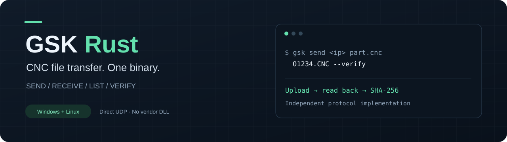

<p align="center"></p>

<p align="center"><a href="README.md">English</a> · <b>Русский</b> · <a href="https://github.com/drockso/gsk-rust/releases/latest">Скачать релиз</a> · <a href="docs/PROTOCOL.md">Протокол</a></p>

# gsk — передача программ GSK по Ethernet

Самостоятельная консольная утилита на Rust. Протокол восстановлен по MiniSock.dll из GSKComm-M и проверен на реальном станке. При работе **не нужны GSKComm, DLL, .NET или установленный Rust**: достаточно одного исполняемого файла под свою ОС.

Реализованы отправка, приём, каталог, размер файла и проверка содержимого обратным чтением. Это замена файлового обмена по Ethernet из прежнего GskSend; управление движением, запуск программ, DNC и RS-232 не входят в интерфейс.

## Готовые сборки

[Последний релиз на GitHub](https://github.com/drockso/gsk-rust/releases/latest): Windows x64 ZIP, Linux x64 TAR.GZ, отдельные бинарники и контрольные суммы SHA-256. Ниже — пути локальных сборок при разработке.

- `artifacts/windows-x64/gsk.exe` — Windows x64, статически включён CRT; импортирует только системные DLL Windows.
- `artifacts/linux-x64/gsk` — Linux x64, статический musl ELF; проверен в Ubuntu 24.04 под WSL, включая связь с реальным станком.

Исходники используют переносимые Rust API. macOS и ARM пока не собраны и не проверены. Совместимость с другими моделями/прошивками GSK пока не подтверждена.

## Запуск

PowerShell, из каталога с `gsk.exe`:

```powershell
# Отправка и обратное чтение с проверкой SHA-256
.\gsk.exe send 192.168.1.100 "C:\NC\деталь.cnc" O1234.CNC --verify

# Короткая форма: IP, локальный файл, имя на станке
.\gsk.exe 192.168.1.100 "C:\NC\деталь.cnc" O1234.CNC --verify

# Скачать файл со станка
.\gsk.exe receive 192.168.1.100 O1234.CNC "C:\NC\получено.cnc"

# Каталог, размер, сравнение без записи на станок
.\gsk.exe list 192.168.1.100
.\gsk.exe stat 192.168.1.100 O1234.CNC
.\gsk.exe verify 192.168.1.100 "C:\NC\деталь.cnc" O1234.CNC
```

В Linux команды те же, исполняемый файл — `./gsk`. При необходимости: `chmod +x gsk`.

Для внешнего запуска из редактора укажите `gsk.exe` и аргументы `send IP "путь к сохранённому файлу" O1234.CNC --verify`. Утилита читает файл с диска, поэтому перед вызовом нужно сохранить правки.

### Поведение файлов

- `send` заменяет существующий файл. `--no-clobber` запрещает запись, если предварительный `stat` нашёл такое имя. Это проверка перед открытием, а не блокировка от другого одновременно работающего клиента.
- `--verify` скачивает записанный файл и сравнивает SHA-256. Без него успех означает подтверждение блоков и закрытия файла контроллером.
- `receive` отказывается заменять локальный файл без `--force`. Результат сначала пишется во временный файл в том же каталоге; ошибка связи или закрытия не повреждает прежний локальный файл.
- Имя программы: латинская `O`, четыре цифры, `.CNC`, например `O1234.CNC`; регистр нормализуется. Номер внутри текста программы **не меняется**. Содержимое, кодировка и переводы строк передаются байт в байт.
- Локальные пути поддерживают кириллицу и пробелы. Удалённый путь — ASCII; стандартный каталог `/user/NCPROG`.
- Перед отправкой создаётся локальная временная копия. Допустимый размер исходника — от 1 до 4 294 967 295 байт по формату протокола; реальный предел памяти станка может быть меньше. На железе проверено до 132 557 байт.
- Запись на станок не атомарна: при обрыве там может остаться частичная программа. Утилита возвращает ошибку и не перезапускает всю загрузку автоматически.

### Настройки

Параметры указываются после подкоманды; подробнее `gsk send --help`:

| Параметр | По умолчанию | Назначение |
|---|---|---|
| `--port` | `6000` | UDP-порт контроллера |
| `--local-port` | `0` | Локальный UDP-порт; 0 — свободный порт от ОС |
| `--timeout-ms` | `3000` | Ожидание одного ответа, диапазон 100–60000 мс |
| `--retries` | `2` | Дополнительные попытки для stat, mount и блоков с явным смещением |
| `--remote-dir` | `/user/NCPROG` | Каталог программ |
| `--dry-run` | выключен | Проверка локальных аргументов без сетевых пакетов |
| `--verbose`, `-v` | выключен | Код операции, номер запроса и длина пакета |

Потерянный ответ на открытие/закрытие файла или чтение каталога не вызывает повтор этого запроса: операция могла уже выполниться. При известном открытом дескрипторе утилита пытается закрыть его также после ошибки или Ctrl+C. Если потерян ответ на само открытие, дескриптор неизвестен и закрыть его невозможно.

Коды завершения: `0` — успех, `2` — аргументы или отказ от перезаписи, `4` — сеть/контроллер/ввод-вывод/протокол, `5` — содержимое при проверке не совпало, `130` — Ctrl+C.

## Сборка и проверки

Нужен Rust с поддержкой edition 2024; разработка и сборки проверены на Rust 1.94.1. Зависимости закреплены в `Cargo.lock`.

```text
cargo build --release --locked
cargo fmt --check
cargo clippy --all-targets --locked -- -D warnings
cargo test --locked
python -X utf8 tests/integration.py target/release/gsk.exe
```

В Linux последняя команда: `python3 tests/integration.py target/release/gsk`.

Кросс-сборка статического Linux x64 из PowerShell на Windows:

```powershell
rustup target add x86_64-unknown-linux-musl
$rustSysroot = rustc --print sysroot
$env:CARGO_TARGET_X86_64_UNKNOWN_LINUX_MUSL_LINKER = Join-Path $rustSysroot 'lib\rustlib\x86_64-pc-windows-msvc\bin\rust-lld.exe'
cargo build --release --locked --target x86_64-unknown-linux-musl
```

Интеграционные тесты запускают CLI против локального UDP-эмулятора, который слушает **только 127.0.0.1**. Проверяются границы блоков, двоичная точность, Unicode в локальном пути, потери и чужие/устаревшие ответы, ошибки контроллера, защита от перезаписи, каталог с несколькими страницами, повреждённое чтение, SHA-256 и Ctrl+C на POSIX. Они не обращаются к станку.

Результаты настоящего обмена: [docs/HARDWARE-2026-11-07.md](docs/HARDWARE-2026-11-07.md). Восстановленный протокол и границы знания: [docs/PROTOCOL.md](docs/PROTOCOL.md). Скрипт `research/hardware_test.py --ip <IP> --run` пишет только O3996/O3997 и отказывается запускать тест, если они уже существуют. Повторный запуск сейчас намеренно завершится отказом.

## Файлы проекта

- `src/wire.rs` — формат пакетов, контроль длины/маршрутизации/номера запроса.
- `src/client.rs` — UDP, файловые операции, повторы, закрытие дескрипторов.
- `src/main.rs` — CLI, временные копии, атомарная публикация скачивания, SHA-256.
- `tests/integration.py` — проверка настоящего бинарника с локальным эмулятором.
- `research/wire-fixtures.json` — исходные запросы и ответы read-only исследования.
- `research/probe_readonly.py` — воспроизведение read-only захвата для тестового стенда.

Исходный DLL не включён в проект и не загружается утилитой.
